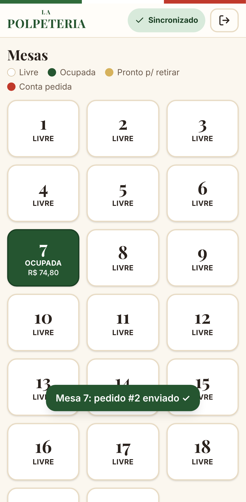
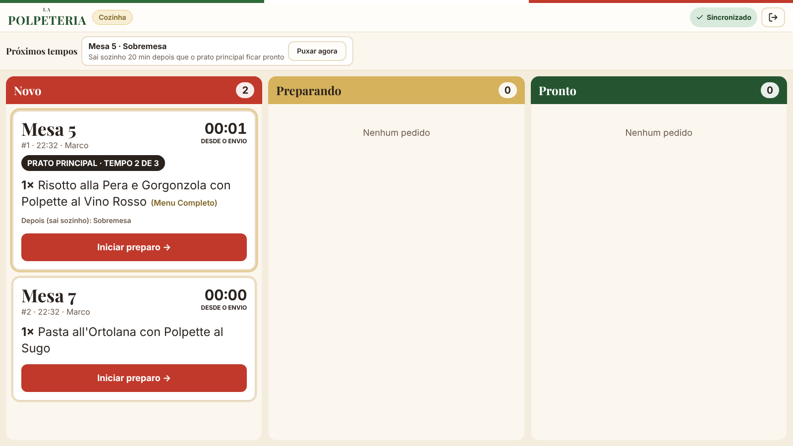
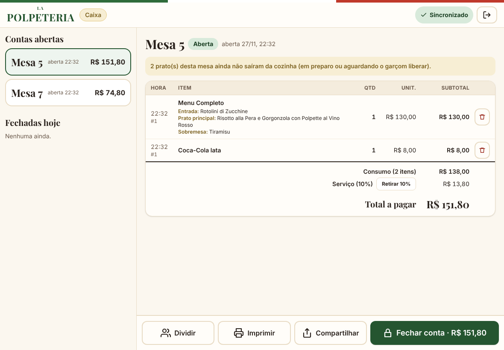
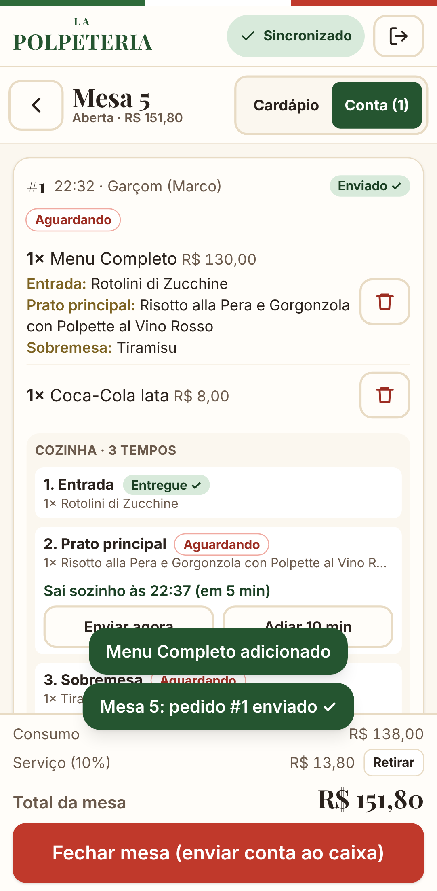
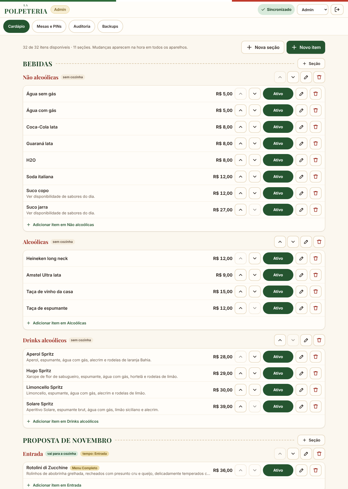
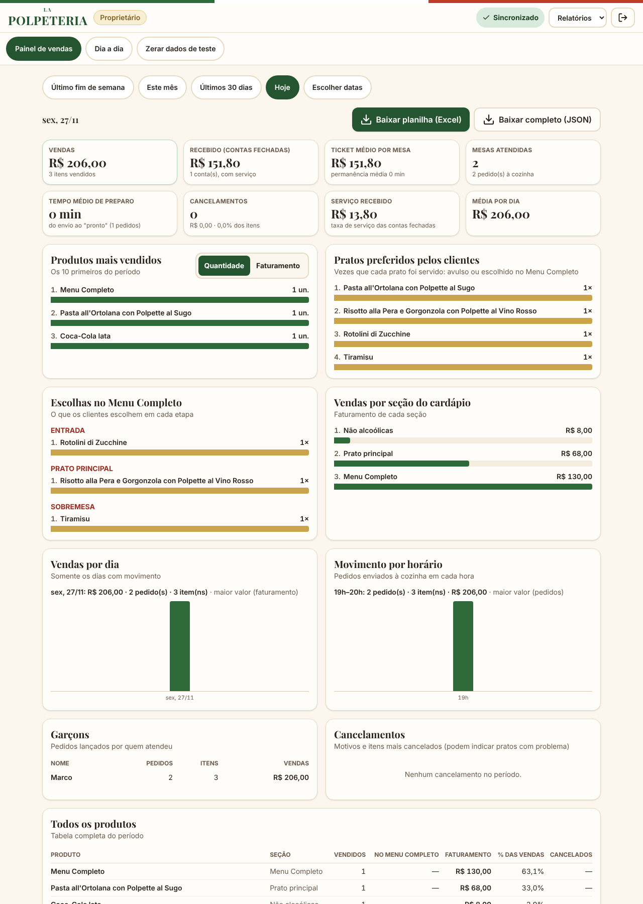

# La Polpeteria — sistema de pedidos

Sistema de pedidos em tempo real para salão e cozinha. O garçom lança o pedido em poucos toques no celular ou tablet. O pedido aparece na tela da cozinha em milissegundos, e o caixa fecha a conta a partir dos mesmos dados, com garantia de que nada se perde, se duplica ou é alterado sem registro.

| Garçom (celular) | Cozinha (tela grande) | Caixa |
| --- | --- | --- |
|  |  |  |

| Tempos do Menu Completo (garçom) | Edição do cardápio (Admin) | Relatórios (Proprietário) |
| --- | --- | --- |
|  |  |  |

## Como rodar (um comando)

Pré-requisito: [Node.js](https://nodejs.org) 20 ou superior (recomendado 22 LTS).

```bash
npm install && npm start
```

O `npm install` instala as dependências e compila a interface. O `npm start` inicia o servidor e mostra os endereços de acesso:

```
  La Polpeteria — sistema de pedidos
  Dados em: /caminho/do/projeto/data
  Neste computador:   http://localhost:3000
  Na rede (Wi-Fi):    http://192.168.0.15:3000
```

### PINs padrão (altere em Admin → Mesas e PINs)

| Perfil | PIN | Acesso |
| --- | --- | --- |
| Garçom | `1111` | mesas, pedidos, cancelamento com motivo, "fechar mesa" |
| Cozinha | `2222` | quadro Novo → Preparando → Pronto (não cancela nem apaga) |
| Admin | `3333` | tudo nas telas acima, mais cardápio, mesas, PINs, auditoria e backups |
| Caixa | `4444` | conta por mesa, divisão, impressão, fechamento e reabertura (com PIN de Admin) |
| **Proprietário** | `5555` | tudo o que o Admin faz, mais **relatórios e gráficos de vendas** e exportação para Excel |

Em um banco que já estava em uso, o PIN do Proprietário é criado como `5555`; se algum perfil já usar esse número, o sistema usa o próximo livre (`5556`, …). Só o Proprietário troca o próprio PIN.

O perfil fica lembrado no aparelho até alguém tocar em "Sair".

## Uso no restaurante (rede local / Wi-Fi)

1. Escolha um computador que fique ligado durante o expediente, por exemplo o do caixa. Desative a suspensão automática.
2. Rode `npm install && npm start` nele.
3. Nos celulares, tablets e na TV da cozinha, conectados **ao mesmo Wi-Fi**, abra o endereço "Na rede (Wi-Fi)" mostrado no terminal, por exemplo `http://192.168.0.15:3000`.
4. **IP fixo:** no roteador, reserve o IP desse computador (opção "DHCP reservado" ou "IP fixo"). Assim o endereço não muda.
5. **Windows:** na primeira execução, permita o Node.js no Firewall para "Redes privadas". Sem isso, os aparelhos não conseguem acessar o servidor.
6. **Iniciar sozinho:** use `npx pm2 start server/index.js --name polpeteria && npx pm2 save`. Também é possível criar uma tarefa no Agendador de Tarefas do Windows que execute `npm start` na pasta do projeto ao ligar o computador.

### Instalar como aplicativo na tela inicial (PWA)

- **Android (Chrome):** menu ⋮ → "Adicionar à tela inicial".
- **iPhone/iPad (Safari):** Compartilhar → "Adicionar à Tela de Início".

Os navegadores só ativam todos os recursos de PWA, entre eles o cache da interface para abrir sem rede, em **HTTPS** ou em `localhost`. Pela rede local em `http://`, o atalho funciona, e a fila de pedidos offline (IndexedDB) também. Só não é possível *recarregar* a página sem rede. Para ter tudo na rede local, há duas opções:

- **HTTPS local:** gere um certificado com [mkcert](https://github.com/FiloSottile/mkcert) (`mkcert 192.168.0.15`), instale a CA nos aparelhos e inicie com `HTTPS_KEY=caminho/chave.pem HTTPS_CERT=caminho/cert.pem npm start`.
- **Nuvem** (abaixo): o HTTPS já vem pronto.

## Publicar na nuvem

> **Regra de ouro:** o banco precisa ficar em **disco persistente**. O servidor **se recusa a iniciar** no Render ou no Railway se não encontrar um disco persistente configurado (`DATA_DIR`), para evitar a perda de pedidos a cada deploy. Rode **uma única instância**: o SQLite e o tempo real ficam no mesmo processo.

### Render

1. Envie o repositório ao GitHub.
2. No Render: **New → Blueprint** e selecione o repositório. O arquivo `render.yaml` já define:
   - comando de build `npm install` e de início `npm start`;
   - **disco persistente** de 1 GB em `/var/data`, com `DATA_DIR=/var/data`;
   - `TZ=America/Sao_Paulo`, que define o "dia" do histórico e das exportações.
3. Discos persistentes exigem plano pago (Starter). O plano gratuito usa disco temporário e não serve para este sistema.

### Railway

1. **New Project → Deploy from GitHub repo**.
2. No serviço, clique em **+ Volume** e monte em `/data`. O Railway define `RAILWAY_VOLUME_MOUNT_PATH`, que o servidor usa automaticamente.
3. Em *Variables*, adicione `TZ=America/Sao_Paulo`.
4. Em *Settings → Networking*, gere um domínio público. O `railway.json` já define o início, o *health check* e 1 réplica.

## Segurança dos pedidos (como cada garantia é cumprida)

| Requisito | Implementação |
| --- | --- |
| Gravação antes da resposta | SQLite em **WAL** com `synchronous=FULL`, em transação síncrona. O servidor só responde depois do `COMMIT` em disco. O aparelho só mostra **"Enviado ✓"** com essa confirmação; até lá o pedido aparece como **"Pendente"**. |
| Sem internet, sem perda | Cada pedido é gravado primeiro no **IndexedDB** do aparelho (com `durability: strict`) e então enviado. Sem rede, fica pendente e é reenviado sozinho: *backoff*, evento `online` e reconexão do socket. Sobrevive a recarregar a página e a fechar o app. |
| Sem duplicatas | **UUID gerado no aparelho** é a chave primária do pedido. Reenvios retornam o pedido existente (`duplicate: true`) e ficam registrados na auditoria. O mesmo UUID com conteúdo diferente é recusado (`ID_CONFLICT`). Cancelamentos também têm UUID próprio. |
| Indicador sempre visível | Cabeçalho mostra **"Sincronizado"**, **"X pedidos pendentes"**, "X recusados" ou "Reconectando…". |
| Nada é apagado | Itens enviados são **imutáveis**. Cancelar cria um registro à parte com quantidade, **motivo**, horário, perfil, nome e aparelho. **Gatilhos no próprio SQLite** bloqueiam `DELETE`/`UPDATE` em pedidos, itens, cancelamentos, contas e auditoria, mesmo que alguém edite o banco diretamente. A cozinha não tem permissão para cancelar. |
| Log de auditoria | Toda criação, reenvio, mudança de status, cancelamento, fechamento, reabertura (inclusive tentativas negadas), alteração de cardápio, de configurações e de PIN, login e exportação. É **somente-inserção e encadeado por hash SHA-256**; o botão "Verificar integridade" detecta adulteração. |
| Preço congelado | Nome, categoria, preço e escolhas do Menu Completo são copiados para o item no momento do pedido. Mudar o cardápio depois não altera contas abertas. |
| Dois garçons na mesma mesa | Índice único "uma conta aberta por mesa" mais transações serializadas: pedidos simultâneos só **somam** itens na mesma conta. Mudanças de status usam concorrência otimista (`from → to`): o segundo toque com dado antigo é recusado e o aparelho atualiza. |
| Caixa | Conta por mesa com horário, quantidade, valor unitário, subtotal e total. Cancelados aparecem à parte, fora do total. **Fechar exige o total conferido**: se algo mudou nesse meio-tempo, o fechamento é recusado. A mesa fica travada; reabrir exige **PIN de Admin** e fica registrado. Divisão exata em centavos, impressão (80 mm/A4) e compartilhamento. |
| Conta fechada × garçom offline | Um pedido feito offline para uma conta que o caixa fechou nesse intervalo é **recusado de forma visível** no aparelho, nunca descartado em silêncio. O garçom pode enviá-lo para uma nova conta da mesa. |
| Backup e recuperação | Backup online do SQLite **a cada 10 minutos** (quando houve movimento) e na inicialização, mantendo os **últimos 50** em `data/backups/`. Exportação automática do dia anterior em **CSV e JSON** em `data/exports/`. Botão "Fazer backup agora" no Admin; relatórios em planilha (Excel/JSON) na tela do Proprietário. |
| Reinício do servidor | Sessões ficam no banco: após reiniciar, os aparelhos reconectam sozinhos, sem novo PIN, baixam o estado completo e enviam o que estava pendente. |

### Começar a operação do zero (uma única vez)

Depois dos testes e antes de abrir para clientes, o **Proprietário** entra em **Relatórios → Zerar dados de teste**, digita o próprio PIN e a palavra **ZERAR**. O sistema:

1. faz um **backup completo** (`data/backups/…_antes-de-zerar.sqlite`);
2. apaga pedidos, contas (inclusive abertas), cancelamentos, fila da cozinha, auditoria e relatórios gerados;
3. mantém cardápio, seções, configurações, PINs e os aparelhos conectados;
4. avisa todos os aparelhos, que descartam rascunhos e pedidos de teste guardados localmente (inclusive celulares que estavam offline: ao voltar, sincronizam antes de reenviar qualquer coisa);
5. começa uma auditoria nova, cujo primeiro registro é a própria limpeza (quem, quando e qual backup);
6. **desativa a opção**: a partir daí os dados reais não podem ser apagados. Em caso excepcional, ela só volta definindo a variável `ALLOW_RESET=1` no servidor.

### Restaurar um backup

1. Pare o servidor (Ctrl+C).
2. Guarde o banco atual em outra pasta: `data/polpeteria.db` e, se existirem, `-wal` e `-shm`.
3. Copie o backup desejado de `data/backups/` para `data/polpeteria.db` e apague `polpeteria.db-wal` e `polpeteria.db-shm`.
4. Inicie o servidor (`npm start`).

## Cardápio

O cardápio inicial é o da casa (arquivo `server/catalog.js`), organizado nas seções do cardápio impresso:

- **Bebidas:** Não alcoólicas · Alcoólicas · Drinks alcoólicos.
- **Proposta do mês** (o título, por exemplo "Proposta de Novembro", é editado em Admin → Mesas e PINs): Entrada · Prato principal · Sobremesa · Menu Completo.
- **Carta de vinhos:** Vinhos tintos · Vinhos brancos · Vinho em taça.
- **Outros:** Taxa de rolha (R$ 30) e o botão da taxa de serviço.

### Edição livre no Admin (aba Cardápio)

- **Itens:** criar, editar (nome, descrição, preço, seção), ativar/desativar, mudar a ordem (setas) e excluir. Se o item já foi pedido, ele é arquivado em vez de apagado, para as contas antigas continuarem corretas.
- **Seções:** criar, renomear (os itens acompanham), mudar a ordem, mover para outra parte do cardápio e excluir (somente seções vazias). Para cada seção:
  - **vai para a tela da cozinha** ou não (bebidas e "Outros" não vão; só entram na conta);
  - **tempo no Menu Completo** (Entrada, Prato principal, Sobremesa ou o próprio Menu Completo);
  - **entra no cálculo dos 10%** ou não ("Outros" vem fora).

### Menu Completo em tempos (automático)

O garçom toca no Menu Completo e escolhe prato principal e sobremesa (a entrada, por ser única, já vem marcada). Ao enviar, **ninguém precisa lembrar de liberar nada**:

1. a **Entrada** vai para a cozinha na hora;
2. quando a cozinha marca a entrada como **Pronto**, o **Prato principal** é agendado e **sai sozinho** depois de um intervalo (padrão: **5 min**);
3. quando o prato principal fica **Pronto**, a **Sobremesa** sai sozinha depois de outro intervalo (padrão: **20 min**);
4. cada tempo tem o próprio andamento (Novo → Preparando → Pronto) e o próprio check de **"Entregue ✓"**.

Os intervalos são ajustados em Admin → Mesas e PINs. O garçom vê "Sai sozinho às 20:45 (em 12 min)" e tem botões **opcionais** para exceções: **Enviar agora** e **Adiar 10 min**. A cozinha vê a faixa **"Próximos tempos"** com contagem regressiva e pode **Puxar agora**. Se a entrada for cancelada, o que restar do prato principal sai na hora; se a cozinha desfizer o "Pronto", o agendamento é cancelado. O horário fica gravado no banco (vale mesmo se o servidor reiniciar), e toda saída automática fica na auditoria.

Prato avulso pedido junto com um Menu Completo acompanha o tempo da sua seção (por exemplo, um prato principal avulso sai junto com o prato principal do menu). O caixa cobra o preço do Menu Completo (R$ 130), não a soma avulsa.

### Taxa de serviço

Calculada automaticamente (padrão 10%) sobre as seções que entram no serviço. Garçom (aba Conta da mesa ou seção "Outros") e caixa **incluem ou retiram** com um toque; cada mudança fica na auditoria. O fechamento da conta usa o total com serviço, e a divisão da conta também. Percentual e "incluir automaticamente nas mesas novas" são configurados em Admin → Mesas e PINs.

## Relatórios do Proprietário

Entre com o PIN do Proprietário. A tela **Relatórios** tem dois painéis:

- **Painel de vendas** (último fim de semana, este mês, últimos 30 dias, hoje ou datas escolhidas): vendas, valor recebido, ticket médio por mesa, mesas atendidas, tempo médio de preparo, cancelamentos; gráficos de **produtos mais vendidos** (por quantidade ou faturamento), **pratos preferidos** (avulsos + escolhidos no Menu Completo), **escolhas no Menu Completo**, vendas por seção, por dia e por horário; desempenho por garçom; motivos de cancelamento; tabela completa de produtos. Atualiza sozinho durante o serviço.
- **Dia a dia:** contas, pedidos e cancelamentos de um dia.
- **Baixar planilha (Excel)** ou **completo (JSON)** do período escolhido.

"Preferência" é medida pelo que os clientes pedem; o sistema não coleta avaliações.

## Testes

```bash
npm test       # 41 testes: pedidos, tempos da cozinha, taxa de serviço, cardápio editável, relatórios e os 5 cenários críticos
npm run e2e    # navegador real (34 verificações): garçom, cozinha, caixa, Proprietário e Admin, com queda de rede
```

`npm test` sobe o servidor real em processos separados e cobre:

1. **Queda de internet durante o envio:** sem rede antes de chegar ao servidor; rede caindo *depois* de o servidor gravar (resposta perdida); servidor desligado com vários pedidos na fila; conta fechada enquanto o garçom estava offline.
2. **Reenvio duplicado:** o mesmo UUID reenviado 25 vezes (5 em sequência e 20 em paralelo) gera 1 pedido. Conteúdo adulterado com o mesmo UUID é recusado. Cancelamento reenviado não cancela em dobro.
3. **Reinício do servidor com pedidos abertos:** queda brusca (`SIGKILL`) e reinício normal. Estado idêntico, integridade do arquivo, cadeia de auditoria válida, reconexão automática dos aparelhos e envio do pedido que estava pendente.
4. **Dois garçons na mesma mesa:** 20 pedidos simultâneos em mesa livre caem numa única conta, cada um intacto e com o autor certo.
5. **Conferência:** total do caixa = soma dos itens enviados − cancelados, centavo a centavo, com troca de preço no meio, cancelamentos parciais e totais, Menu Completo, fechamento, bloqueios e reabertura.

O `npm run e2e` requer Playwright com Chromium (`npx playwright install chromium`).

## Configuração (variáveis de ambiente)

| Variável | Padrão | Função |
| --- | --- | --- |
| `PORT` | `3000` | Porta HTTP |
| `HOST` | `0.0.0.0` | Interface de rede (o padrão aceita acesso da rede local) |
| `DATA_DIR` | `./data` | Pasta do banco, backups e exportações (na nuvem: o disco persistente) |
| `TZ` | `America/Sao_Paulo` | Fuso que define o "dia" do histórico e da numeração dos pedidos |
| `BACKUP_INTERVAL_MINUTES` | `10` | Intervalo dos backups automáticos |
| `BACKUP_KEEP` | `50` | Quantidade de backups mantidos |
| `HTTPS_KEY` / `HTTPS_CERT` | — | Caminhos do certificado para servir em HTTPS |
| `ALLOW_RESET` | — | `1` reativa "Zerar dados de teste" depois de já usado (excepcional) |

## Estrutura

```
server/          Express + Socket.IO + SQLite
  db.js          esquema e gatilhos de proteção
  services.js    regras de negócio (pedidos, cancelamentos, contas, Menu Completo)
  audit.js       log de auditoria encadeado por hash
  backup.js      backups e exportações CSV/JSON
  catalog.js     cardápio oficial e sincronização do banco
  seed.js        configurações iniciais e atualizações de dados
client/          React + Vite + Tailwind (PWA)
  src/lib/outbox-core.js   fila offline + envio HTTP (mesmo código usado nos testes)
  src/lib/store.js         estado, tempo real versionado, sessão
  src/screens/             garçom, cozinha, caixa, admin, proprietário (relatórios)
shared/constants.js        categorias, etapas do Menu Completo, atalhos de observação
tests/                     testes automatizados (node:test)
scripts/e2e-duas-abas.mjs  teste ponta a ponta no navegador
```

Para desenvolvimento com recarga automática, use dois terminais: `npm run dev:server` e `npm run dev:client`, e abra `http://localhost:5173`.

## Limitações conhecidas e próximos passos

- Pedidos sem Menu Completo saem para a cozinha em um tempo só (entrada e prato avulsos juntos). Para segurar um prato avulso, lance-o num pedido separado mais tarde.
- O "dia" do histórico é o dia do calendário no fuso configurado. Um serviço que passe da meia-noite aparece em dois dias.
